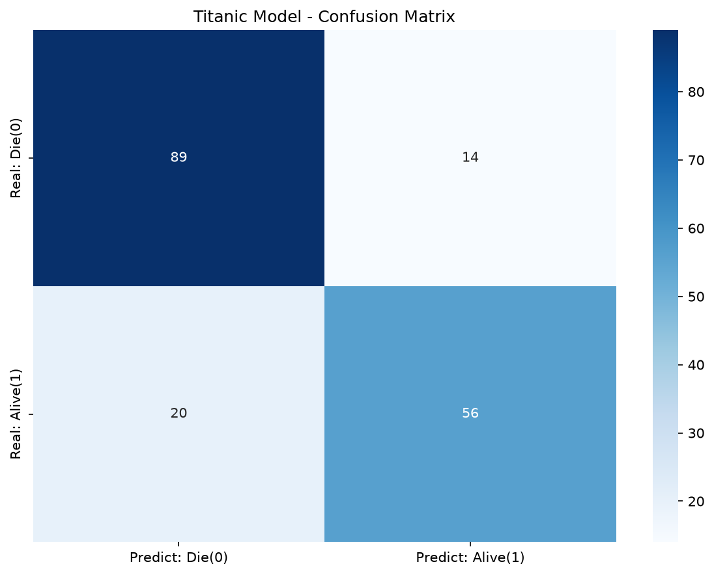

# Titanic Survival Prediction

A small machine learning project that predicts whether a Titanic passenger survived. It uses the Kaggle Titanic training data, preprocesses passenger features, trains a logistic regression classifier, and visualizes its predictions with a confusion matrix.

## Project files

- `project1.py` — data preparation, model training, evaluation, and confusion matrix generation.
- `train.csv` — labeled passenger data used to train and evaluate the model.
- `test.csv` and `gender_submission.csv` — additional Kaggle data files included in the repository; the current script does not use them.
- `confusion_matrix.png` — confusion matrix produced by the latest run of `project1.py`.

## Requirements

Python 3 and the following packages are required:

```bash
pip install pandas seaborn numpy matplotlib scikit-learn
```

## Run

Run the script from the project directory so it can find `train.csv`:

```bash
python project1.py
```

The script prints the test-set accuracy and displays the confusion matrix. It also saves the latest chart as `confusion_matrix.png` in the project directory.

## Model workflow

1. Drops passenger ID, name, ticket, and cabin columns.
2. Fills missing ages with the median and missing embarkation ports with the most frequent value.
3. Encodes gender and embarkation port as numeric features.
4. Splits the data into training and test sets (80/20, with a fixed random state).
5. Fits a logistic regression model and reports accuracy on the test set.

## Latest confusion matrix

The chart below shows the model's predictions on the held-out test split. Rows are actual outcomes and columns are predicted outcomes.


